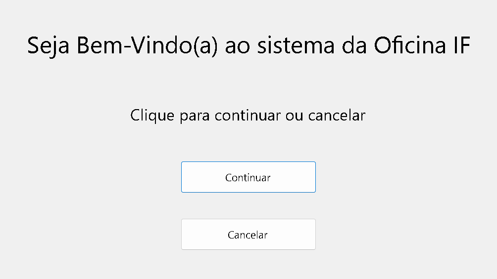
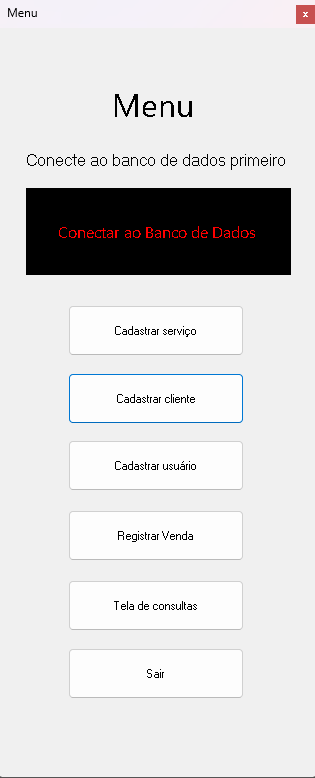
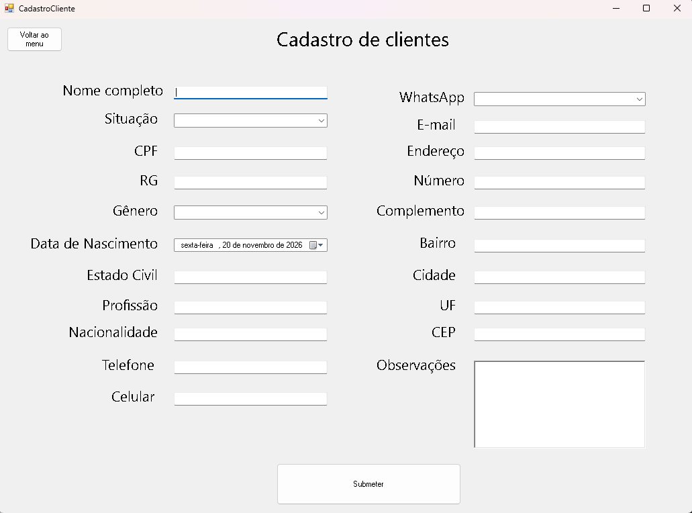
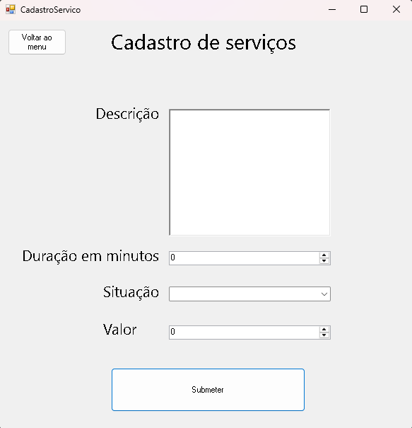
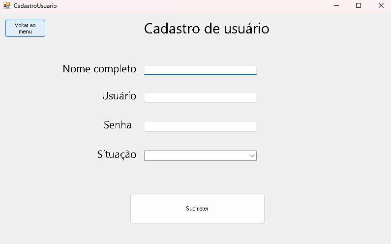
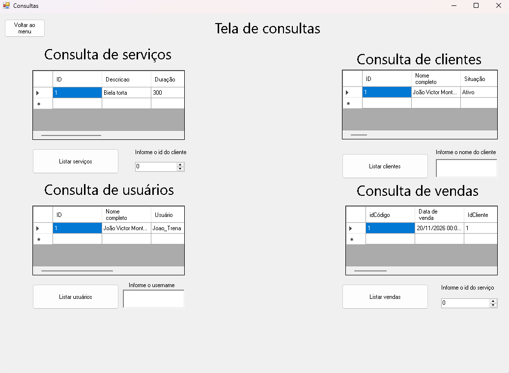

<h1 align="center" style="font-weight: bold;">Oficina IF</h1>

<p align="center">
    <b>Aplicativo desktop para gerenciamento de clientes, serviços e vendas de uma oficina.</b>
</p>

[DOTNET__BADGE]: https://img.shields.io/badge/.NET_Framework-4.7.2-512BD4?style=for-the-badge&logo=dotnet&logoColor=white
[CSHARP__BADGE]: https://img.shields.io/badge/C%23-512BD4?style=for-the-badge&logo=csharp&logoColor=white
[WINFORMS__BADGE]: https://img.shields.io/badge/Windows_Forms-0078D4?style=for-the-badge&logo=windows&logoColor=white
[MYSQL__BADGE]: https://img.shields.io/badge/MySQL-4479A1?style=for-the-badge&logo=mysql&logoColor=white

<p align="center">
 <a href="#tech">Tecnologias</a> •
 <a href="#started">Iniciando</a> •
 <a href="#layout">Layout/Preview</a> •
 <a href="#features">Funcionalidades</a> •
 <a href="#colab">Colaboradores</a> •
 <a href="#contribute">Contribua</a>
</p>

<p align="center">
    Projeto acadêmico desenvolvido para a disciplina de Linguagens de Programação do curso de Análise e Desenvolvimento de Sistemas do IFSP.
</p>

<h2 id="layout">🎨 Layout/Preview</h2>

<p align="center">
    Telas de boas-vindas, menu, cadastros e consultas do sistema.
</p>

<table>
    <tr>
        <td align="center" width="50%">
            <strong>Boas-vindas</strong><br><br>
            
        </td>
        <td align="center" width="50%">
            <strong>Menu principal</strong><br><br>
            
        </td>
    </tr>
    <tr>
        <td align="center" width="50%">
            <strong>Cadastro de clientes</strong><br><br>
            
        </td>
        <td align="center" width="50%">
            <strong>Cadastro de serviços</strong><br><br>
            
        </td>
    </tr>
    <tr>
        <td align="center" width="50%">
            <strong>Cadastro de usuários</strong><br><br>
            
        </td>
        <td align="center" width="50%">
            <strong>Consultas</strong><br><br>
            
        </td>
    </tr>
</table>

<h2 id="tech">💻 Tecnologias</h2>

![.NET Framework][DOTNET__BADGE]
![C#][CSHARP__BADGE]
![Windows Forms][WINFORMS__BADGE]
![MySQL][MYSQL__BADGE]

<h2 id="features">✨ Funcionalidades</h2>

- Cadastro de clientes, usuários e serviços.
- Registro e consulta de vendas.
- Consultas de clientes, serviços e usuários.
- Armazenamento dos dados em MySQL.

<h2 id="started">🚀 Iniciando</h2>

O projeto é um aplicativo Windows Forms para Windows. Para usar as funções de cadastro, consulta e vendas, configure também o servidor MySQL.

<h3>Pré-requisitos</h3>

- Windows.
- Visual Studio 2022 com a carga **Desenvolvimento para desktop com .NET** e o **Pacote de Desenvolvimento do .NET Framework 4.7.2**. Alternativamente, use o .NET SDK e instale o pacote de direcionamento do .NET Framework 4.7.2.
- MySQL Server 8.0 ou compatível, em execução local.
- Git.

<h3>Clonando</h3>

```powershell
git clone https://github.com/JoaoxVictorMS/Oficina_IF.git
cd Oficina_IF
```

<h3>Preparando o banco de dados</h3>

Na raiz do repositório, execute o script para criar o banco `Oficina` e as tabelas necessárias. Se o cliente MySQL estiver no `PATH`:

```powershell
Get-Content -Raw .\Oficina_IF\database\schema.sql | mysql -u root -p
```

No Windows, se `mysql` não for reconhecido, use o caminho do cliente instalado. Exemplo para MySQL Server 8.0:

```powershell
Get-Content -Raw .\Oficina_IF\database\schema.sql | & "C:\Program Files\MySQL\MySQL Server 8.0\bin\mysql.exe" -u root -p
```

Informe a senha do MySQL `root` quando solicitado. Se o MySQL foi instalado em outro diretório ou versão, ajuste o caminho do executável.

O aplicativo conecta ao servidor local com o usuário `oficina_app`. No cliente MySQL, conectado como administrador, crie esse usuário e conceda acesso somente ao banco do aplicativo. Substitua o exemplo por uma senha exclusiva sua:

```sql
CREATE USER 'oficina_app'@'localhost' IDENTIFIED BY 'SUBSTITUA_POR_UMA_SENHA_FORTE';
GRANT ALL PRIVILEGES ON Oficina.* TO 'oficina_app'@'localhost';
```

Se `oficina_app` já existir, não execute novamente o `CREATE USER`; confira ou conceda a permissão com o comando `GRANT`.

<h3>Configurando a senha do banco</h3>

A senha do MySQL não deve ser gravada no código nem enviada ao GitHub. Crie uma variável de ambiente do Windows chamada `OFICINA_DB_PASSWORD`, com o mesmo valor definido para `oficina_app`:

1. Abra **Editar as variáveis de ambiente da sua conta** pelo menu Iniciar.
2. Em **Variáveis de usuário**, selecione **Novo**.
3. Use `OFICINA_DB_PASSWORD` como nome e informe a senha de `oficina_app` como valor.
4. Feche e reabra o terminal ou o Visual Studio para carregar a variável.

O arquivo `.env` não é utilizado por este projeto. A configuração do host, usuário e banco fica em `App.config`; a senha é lida da variável de ambiente.

<h3>Compilando</h3>

Na raiz do repositório, execute:

```powershell
dotnet build .\Oficina_IF\Oficina_IF.sln --configuration Debug
```

O NuGet restaura o conector MySQL e suas dependências durante a compilação. Também é possível abrir `Oficina_IF\Oficina_IF.sln` no Visual Studio e iniciar com **F5**.

<h3>Executando</h3>

Após compilar, execute:

```powershell
& .\Oficina_IF\Oficina_IF\bin\Debug\Oficina_IF.exe
```

Na tela inicial, clique em **Continuar**. O login atual é de demonstração e usa credenciais fixas no código:

| Usuário   | Senha  |
| --------- | ------ |
| `joao`    | `1234` |
| `Leticia` | `5678` |
| `Max`     | `abcd` |

Esse login não autentica pelo banco de dados. No menu, use **Conectar ao banco de dados** para habilitar as operações que dependem do MySQL.

<h2>🛡️ Aviso de segurança</h2>

Este é um projeto acadêmico e ainda não está adequado para produção ou para dados reais. O login de demonstração está no código, senhas cadastradas são armazenadas sem hash e algumas consultas SQL são montadas com valores digitados pelo usuário. Use apenas dados fictícios até que esses pontos sejam corrigidos.

<h2 id="colab">🤝 Colaboradores</h2>

<p>Um agradecimento especial a quem contribuiu para este projeto.</p>

<table>
  <tr>
    <td align="center">
      <a href="https://github.com/JoaoxVictorMS">
        <br>
        <sub>
          <b>João Victor</b>
        </sub>
      </a>
    </td>
  </tr>
</table>

<h2 id="contribute">📫 Contribua</h2>

1. Faça um fork do repositório.
2. Crie uma branch para sua alteração: `git checkout -b feature/minha-alteracao`.
3. Faça commits objetivos e relacionados à mudança.
4. Abra um pull request descrevendo o que foi alterado e como validar.

<h3>Documentação útil</h3>

- [Como criar um pull request](https://docs.github.com/pt/pull-requests/collaborating-with-pull-requests)
- [.NET Framework 4.7.2](https://dotnet.microsoft.com/download/dotnet-framework/net472)
- [MySQL Installer para Windows](https://dev.mysql.com/downloads/installer/)
